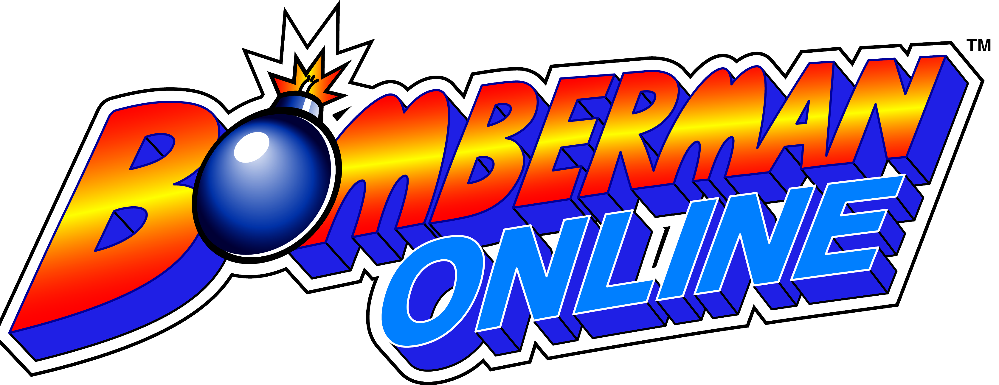

<p align="center">
  
</p>

<h1 align="center">Bomberman Online — native recompilation</h1>

<p align="center">
  <a href="https://recompstore.com/dev/nvd123-yt"></a>
  
  <a href="https://playported.com/ports/1390-bomberman-online/"></a>
  <a href="https://recomplauncher.com/game/bombermanonlinerecomp"></a>
</p>

A native C/C++ recompilation of **Bomberman Online** (Sega Dreamcast, USA, MK-51065 V1.004),
built on [dreamcomp](https://github.com/phobos665/dream-recomp)-style static SH-4 recompilation,
with working original online multiplayer via DCNet and a cross-platform Electron launcher.

The original game is © SEGA / HUDSON SOFT. **This public repository and its releases contain no
copyrighted game data.** Release downloads include a prebuilt native executable; players still
supply their own Bomberman Online disc image (`.chd`) for the game's runtime disc reads.

## What is here

| Path | Purpose |
|---|---|
| `game/bomberman_online.toml` | Measured game config for `dream-translate` (disc SHA-1, load/link address) |
| `src/bomberman_online.cpp` | Port registration and device/MMIO handlers |
| `game/bindings.txt` | Documented default keyboard/gamepad input bindings |
| `tools/launcher/` | Cross-platform Electron launcher (disc browse, Play, online, resolution, controller remap, logs) |
| `tools/dc.sh` | Run dreamcomp's CLI with the local toolchain environment |
| `tools/env.sh` | Local paths (dreamcomp, Java, Ghidra, libchdr) — no system installs |
| `docs/GAME-INTERNALS.md` | Reverse-engineered facts, with evidence and confidence |
| `docs/PLAN.md` | Milestones, gates, verified checkpoints |

## Build

Prerequisites: CMake 3.24+, Ninja, a C++20 compiler, Python 3, and an extracted boot file from your
own disc. The dreamcomp engine is vendored at `./dreamcomp`; nothing else needs checking out.
A windowed build also needs SDL3 and Vulkan (the Vulkan SDK provides `glslc`); on macOS, MoltenVK
and a `glslc` on `PATH` (or the repository's libshaderc-driven shim) are enough.

```sh
tools/dc.sh setup . --disc "/path/to/Bomberman Online (USA).chd"
tools/dc.sh build .            # headless-capable build
tools/dc.sh report . --frames 600
```

`setup` reads the boot binary straight from your image. `.gdi` and `.cue` need nothing extra; for
`.chd`, the vendored libchdr is built once on first use so no system package is required.

The game executable is generated into `build/game/bomberman-online` and is never committed. The
generated SH-4 code is compiled as eight translation units in parallel; the build prints a
heartbeat with the number of parts finished so a long first build does not look hung.

## Launcher

The Electron launcher replaces the old Tk UI. Build and run it:

```sh
cd tools/launcher
npm ci
npm start                      # dev mode
npm run selftest               # verify UI renders on all platforms
npm run package                # electron-builder: .dmg/.zip (macOS), .exe/.zip (Windows), .AppImage/.deb/.tar.gz (Linux)
```

The launcher handles disc selection, Play/Headless/Build/Stop, resolution presets + scale slider,
aspect (native/wide), vSync/fullscreen/FPS/sound, online enable/DCNet server/port, TCP reachability
test, controller test, remap editor, streaming logs, and settings persistence.

**Release downloads are prebuilt:** choose your own disc image once and press **Play**. The
bundled native executable starts directly; the launcher does not run CMake, Ninja, Python, a
compiler, or a local recompilation. The disc image is passed to the game for GD-ROM reads. The
**Build** action is only for developer/source checkouts; packaged releases do not rebuild. User settings and VMU saves remain in the writable app-data workspace across application updates. The status-bar **Check for updates** control checks GitHub Releases, downloads the matching Windows/macOS package (or Linux AppImage), verifies its SHA-256 checksum, and installs it after the launcher closes. The macOS helper replaces the .app bundle directly, so an ad-hoc/unsigned build can update without Electron's signed-app updater. Linux .deb and .tar.gz installs use the Releases page; portable AppImages can update in-app. Disc selection, launcher settings, bindings and the VMU are stored outside the application bundle and are retained.

## RecompLauncher

**Works with [RecompLauncher](https://recomplauncher.com).** Release ZIPs include
`recomplauncher.json` at their top level, and the Linux AppImage embeds it at its AppDir root.
In RecompLauncher, select your own USA Dreamcast image (`.chd`, `.gdi`, or `.cue` with its
associated `.bin` tracks). It starts the bundled native game directly without opening the
standalone Electron interface.

The RecompLauncher settings page exposes render scale (1x–8x), aspect ratio, VSync, window/fullscreen
mode, FPS counter, audio, online play, and BBA/modem selection. By default it follows RecompLauncher's
mode (fullscreen in Big Picture, windowed on desktop); the display setting can override that. Launching
the app normally still opens the existing Bomberman launcher.

The current SDK does not read a Dreamcast game ID from CHD/GDI/CUE images. The profile includes
Redump's 360-byte USA CUE-sheet checksum as a descriptor-only match; it does not verify the three
referenced BIN tracks. CHD and GDI images remain accepted but do not get that CUE-only badge. No
`prepare` step is needed: release builds already contain the native executable and read the player's
disc image at runtime.

## Prebuilt release pipeline

Every release job checks out the boot executable from the private
`nvd123-YT/bombermanprivate` repository, verifies its SHA-1 against
`game/bomberman_online.toml`, and compiles the native game separately for macOS, Windows, and
Linux. The compiled executable and its adjacent runtime/frontend assets are bundled into the
download. The private assets are never uploaded to public artifacts or releases.

The workflow requires a fine-grained GitHub token stored as the
`BOMBERMAN_PRIVATE_TOKEN` Actions secret in this repository. Grant it **Contents: Read-only**
access to `nvd123-YT/bombermanprivate` only. Do not put the token in source files.

## Online (DCNet)

Original online multiplayer is implemented over the BBA + DCNet:

- **Discovery:** UDP to `dcnet.flyca.st:7655`, picks an access point (US East, Europe, South America, US West)
- **TCP:** framed `DCNET\x01` prolog + 2-byte LE length Ethernet frames to the access point
- **DHCP:** Discover → Offer → Request → ACK (assigns IP via DCNet)
- **Flash:** seeded with Flycast's ISP + BBA blocks (netmask `0xFFFFFF00`, IP 0 = DHCP, valid CRCs)

To play online: create a character in Extras Box first (saves to `.dreamcomp/bomberman.vmu`), then enable
online in the launcher and enter online mode in-game.

## Status

| Area | State |
|---|---|
| Disc identification, boot binary, first translation | implemented and verified |
| Native build | headless + windowed builds verified (macOS via MoltenVK) |
| Expansion-device probes | all five mapped as absent devices; `unmapped memory accesses: 0` |
| Translation coverage | `untranslated call targets: 0` after merging modem/BBA function seeds |
| Audio | larger circular buffer (93 ms) + rate control; stuttering resolved |
| BBA / DCNet online | RTL8139 implemented, DCNet transport + DHCP handshake working |
| Game reached title screen | confirmed via scripted input |
| Character creation | VMU `.dreamcomp/bomberman.vmu` contains valid `BOMBERONLINE` save |
| Online connection | TCP established to DCNet access point; DHCP Offer received |
| Launcher | Electron: disc browse, Play, online, resolution, controller remap, logs, settings |
| Packaging | electron-builder: macOS .dmg/.zip, Windows .exe/.zip, Linux .AppImage/.deb/.tar.gz |
| CI | GitHub Actions: native prebuilt game + launcher packages on macOS/Windows/Linux |
| Menu rendering | suspected stretch; true widescreen TBD |

## Repository rules

- **No game data committed:** `.chd`, `.vmu`, `.PVR`, `.AFS`, etc. are all in `.gitignore`
- **No credentials, no Ghidra DBs**
- **No push/publish without authorization**
- Nightly releases are built automatically at 00:00 UTC; tag a commit with `v*` for a formal release

## Community statistics homepage

The repository root \`index.html\` is the **Bomberman Online Recompiled** homepage. GitHub Actions publishes it to GitHub Pages on pushes to \`main\`.

The dashboard is Bomberman-only. Its Cloudflare Worker polls DCNet's public \`/status/api/players\` feed once per minute and accepts only the exact game ID \`bomberman\`. Cloudflare D1 stores pseudonymous player identities, daily activity, session estimates, and concurrent-player snapshots.

**Statistics collection is not live yet.** The D1 database has been created and configured in \`stats/wrangler.toml\`; the remaining steps are to initialize its schema, set the private \`PLAYER_HASH_SECRET\`, deploy the Worker, and connect the Worker URL in \`index.html\`. Follow [\`stats/SETUP.md\`](stats/SETUP.md). Until the collector is connected, the homepage deliberately displays no fabricated counts.

Raw usernames are not stored. Unique-player tracking begins when the collector is first deployed; DCNet's live feed does not provide historical records for earlier players. Polling once per minute can also miss very short sessions.
